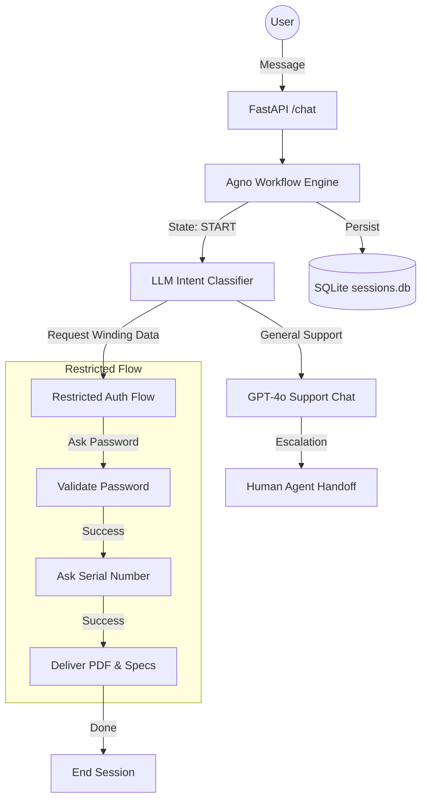

# 🤖 Hercules Motores AI Assistant

[](https://python.org)
[](https://fastapi.tiangolo.com)
[](https://openai.com)
[](https://github.com/agno-agi/agno)
[](LICENSE)

An advanced **AI-powered Support Agent** designed for high-precision technical assistance. Built with **Python**, **FastAPI**, and **Agno (Phidata)**, it features a deterministic state machine strictly guarded by LLMs (GPT-4o) to handle sensitive technical data sharing (Winding Data) and seamless Human Handoff integrations.

---

## 🚀 Key Features

*   **🧠 Hybrid Intelligence**: Combines rigid business logic (State Machine) with fluid conversational AI (GPT-4o) using Structured Outputs.
*   **🔒 Secure Restricted Flows**: Dedicated paths for verifying Serial Numbers and Passwords before releasing sensitive technical documents.
*   **🌐 Omni-Channel Support**: Native integration with **Sunshine Conversations (Zendesk)** for WhatsApp/Web Widget, plus a REST API for custom frontends.
*   **💬 Persistent & Context-Aware**: Uses **SQLite** to persist session state, conversation history, and user metadata across server restarts.
*   **📊 Real-time Dashboard**: Built-in Vue.js Control Panel for monitoring active sessions, KPIs (Success Rate, Channel Split), and live logs.
*   **🤝 Human Handoff**: Intelligent routing to human agents when complex queries arise or authentication fails repeatedly, preserving conversation context (`first_message_id`).

---

## 🛠️ Architecture

The system uses a **Workflow-centric** architecture where the state machine dictates strict transitions, while the LLM acts as a "Copilot" to classify intents and extract entities securely.



---

## 📦 Installation

1.  **Clone the repository:**
    ```bash
    git clone https://github.com/athossouza/HerculesBotV2.git
    cd HerculesBotV2
    ```

2.  **Set up Virtual Environment:**
    ```bash
    python3 -m venv .venv
    source .venv/bin/activate
    ```

3.  **Install Dependencies:**
    ```bash
    pip install -r requirements.txt
    ```

4.  **Configure Environment Variables:**
    Create a `.env` file in the root directory:
    ```env
    OPENAI_API_KEY="sk-..."
    ZENDESK_SUBDOMAIN="your-subdomain"
    SUNSHINE_APP_ID="your-app-id"
    SUNSHINE_KEY_ID="your-key-id"
    SUNSHINE_SECRET="your-secret"
    BUFFER_DELAY_SECONDS=2.0
    ```

---

## 🚦 Usage

### Start the Server
Run the application using Uvicorn with hot-reload enabled:
```bash
python3 -m uvicorn main:app --host 0.0.0.0 --port 8000 --reload
```
*   **API Endpoint:** `http://localhost:8000/chat`
*   **Control Panel:** `http://localhost:8000` (Open in browser)

### Sunshine / WhatsApp Integration
To receive webhooks (e.g., from WhatsApp via Zendesk), expose your local server using **Ngrok**:
```bash
ngrok http 8000
```
Configure your Sunshine Conversations webhook to: `https://<your-ngrok-url>/sunshine/webhook`.

---

## 🧪 Testing

You can interact with the bot using the built-in Dashboard or via `curl`:

**General Chat:**
```bash
curl -X POST "http://localhost:8000/chat" \
     -H "Content-Type: application/json" \
     -d '{"session_id": "test_dev", "message": "hello, I need help with a motor"}'
```

**Voice Analysis (Upload Audio):**
```bash
curl -X POST "http://localhost:8000/voice" \
     -F "session_id=test_voice" \
     -F "file=@/path/to/audio.ogg"
```

---

## 📈 Dashboard

The application includes a **Live Control Panel** (`http://localhost:8000`) providing:

*   **Live Session Tracking**: See who is chatting in real-time.
*   **Channel Analytics**: Distinguish between Web vs. WhatsApp Users.
*   **Success Metrics**: Monitor authentication success rates.
*   **Logs**: View detailed system logs for debugging.

---

## 📄 License

This project is licensed under the MIT License - see the [LICENSE](LICENSE) file for details.

---

*Made with ❤️ by the Hercules Motores Dev Team*
